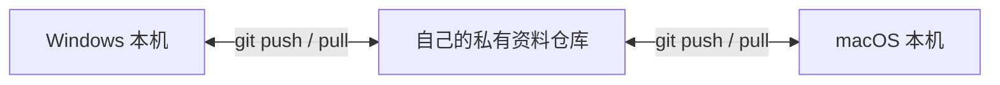

# AgentSync

AgentSync（0.3.0）帮你把选好的 AI 助手规则、技能、人设和记忆文件同步到其他电脑。你在每台电脑上运行几条命令，通过自己的私有 Git 仓库交换更新，也可以让 AI 助手代为执行。

- **同步规则、技能与各自人设**：将你指定的规则文件、技能目录带到其他设备；不同 AI 助手可保留各自独立的人设，互不混用。
- **同步 Markdown 长期记忆**：跨设备共享你自己整理维护的 Markdown 知识与偏好笔记。
- **协同项目代码、任务与交接**：检查并同步独立业务项目的 Git 进度，跨设备记录任务状态与结构化工作交接单。
- **归档可见聊天记录**：保存重要对话档案，并在受支持范围内把文本上下文带入新会话。

文档导航：[新手上手指南](docs/getting-started.md) · [命令与技术参考](docs/reference.md) · [历史归档与能力边界](docs/history.md) · [验证记录](docs/verification.md)

## 它是中心化的吗？

**同步时有中心，使用时各自在本机运行。** 默认用你自己的 GitHub 私有资料仓库作为共同的同步中心；每台电脑都保存本地副本，运行自己的 AI 助手。你不需要另外部署一台常驻服务器。



- **每台电脑保存已同步的资料副本**：本机可以直接读取和修改，其他设备的新改动要等下一次同步才会收到。
- **各助手继续独立工作**：这不是设备之间的实时直连，也不会让多个助手共享账号、模型算力或内部状态。
- **离线照常工作**：断网时可正常修改本机文件，恢复网络后再交换新内容；若 GitHub 暂时不可用，仅跨设备收发暂停，不影响本地使用。
- **GitHub 可以换成其他 Git 托管服务**：程序不依赖 GitHub 专有接口；换用其他兼容远端时，需要重新配置仓库地址和访问权限。

## 哪些能同步？会话能续接到什么程度？

- **规则、技能与独立人设**：只同步你明确绑定的文件或目录，不同助手（或同一助手的不同配置）可以各自保留人设，不会自动拼接覆盖。
- **长期记忆是你管理的文本**：同步的是你自己维护的普通 Markdown / 文本文件，**不是**直接复制各 AI 工具内部的私有记忆数据库。
- **Codex 会话上下文恢复**：支持归档公开可见的聊天记录，并将受支持的纯文本对话上下文注入到**新会话**中——不保留原会话 ID、工具调用或全部内部状态，不属于无损原样迁移。
- **Antigravity / DeepSeek DSH 会话交接**：暂未发现受支持的外部原生导入接口，采用“聊天归档 + 导出 Markdown 交接单”的方式，由你在新会话中交给助手阅读接手。

## 怎么用？

AgentSync 是需要显式运行命令的本机 CLI（你也可以直接让 AI 助手代为执行命令），**没有后台实时自动同步**。每台电脑只需设定一次文件路径绑定，日常使用遵循固定节奏：

- **开始工作前**：收取远端更新 → 查看计划 → 应用到本机工具目录
- **结束工作后**：查看计划 → 收集本机改动到资料库 → 上传到远端

请区分三个日常核心命令的作用边界：

| 命令 | 实际作用 | 会联网吗？ | 会改动工具目录吗？ |
| --- | --- | --- | --- |
| `plan` | 对比本机绑定文件与本地资料库的差异，仅展示计划状态 | 否 | 否 |
| `apply --direction push` 或 `pull` | **仅在本机复制文件**：`push` 从工具路径复制进本地资料库（**不是上传 GitHub**），`pull` 从本地资料库复制回本机工具路径 | 否 | 仅 `pull` 会写入本机目标路径 |
| `git-sync` | 让本地资料库与远端私有仓库**双向同步**（拉取、检查、提交并推送资料库改动） | 是 | **否（不会自动应用到工具目录）** |

**遇到冲突怎么办**：如果本机文件和本地资料库都改了，且内容不同，`plan` 会显示 `conflict`；首次绑定时两边内容不同也会如此。出现任一冲突，**整批 `apply` 都会停止写入**，需要先比对合并。两台电脑的改动也可能在 `git-sync` 的 Git 合并阶段冲突，处理步骤见上手指南。

## 仓库分工与环境要求

可以把它们理解为“工具箱、资料箱、工作项目”三个独立目录：

1. **`agent-sync` 工具源码仓库**：存放本程序代码；本指南从这个目录运行同步命令。
2. **`my-agent-data` 私有资料仓库**：由你另建在独立目录与私有 Git 远端，专门保存同步的规则、记忆、任务与聊天归档。
3. **你的实际业务代码仓库**：开发项目仍使用各自独立的 Git 仓库管理，不放进资料仓库。

**前置要求**：本机安装 **Python 3.11+**、系统 **Git**，并具备你自己的私有 Git 远端访问权限（SSH 或系统凭证管理器）。AgentSync 本身不调用大模型，**不需要购买任何模型 API**。

## 典型场景：公司 Windows 改规则，家里 Mac 收取

两台电脑按[新手上手指南](docs/getting-started.md)完成首次路径绑定后，在各自的工具源码目录执行。将下方 `CONTENT` 换成本机资料仓库路径，先处理好尚未同步的本机改动；`git-sync` 会双向收发。

1. **在公司 Windows 改完规则，收集到资料库并上传**：
   ```sh
   python -m agent_sync --repo "CONTENT" plan
   python -m agent_sync --repo "CONTENT" apply --direction push
   python -m agent_sync --repo "CONTENT" git-sync
   ```
2. **回到家打开 Mac，从远端收取并应用到本机**：
   ```sh
   python3 -m agent_sync --repo "CONTENT" git-sync
   python3 -m agent_sync --repo "CONTENT" plan
   python3 -m agent_sync --repo "CONTENT" apply --direction pull
   ```
3. 重启 AI 助手或新建对话，确认工具已读取更新后的规则文件。

## 进一步阅读

- **从第一台电脑配到第二台电脑**：阅读 [新手上手指南](docs/getting-started.md)，手把手跑通首个规则文件同步。
- **完整命令、技能目录与多人设配置、项目任务交接及安全规则**：阅读 [命令与技术参考](docs/reference.md)。
- **聊天历史归档格式与 Codex 恢复细节**：阅读 [历史归档与能力边界](docs/history.md)。
- **Windows / macOS 测试与真实接口验证说明**：阅读 [验证记录](docs/verification.md)。
